# 👋 Hola, soy Alejandro Maldonado

  
## 🚀 Sobre mí

Actualmente soy estudiante en el campus de programación de 42 School, donde he pasado el último año desarrollando mis habilidades, no solo en programación, sino también a través de su metodología de aprendizaje autodirigido basada en proyectos independientes, que nos ayuda a desarrollar competencias útiles en el entorno laboral, como la resolución de problemas, el trabajo en equipo y el liderazgo de equipos.

  

---

## 🛠️ Tecnologías y herramientas

  

  
  
  
  
  
  
  
  
  
  
  

  

---

## 🦾 Último proyecto completado

  
| UEFA Nations League Predictor | 
|--------------| 
||
|HTML - CSS - JavaScript - Python|
| REACT + Vite - Tailwind - FastApi - Uvicorn |

  

---
## Otros proyectos

|Diseño 10|Rotmansur|
|---------|---------|
|||
|Wordpress - Elementor Pro|Wordpress - Elementor Pro|

  
---

# 🧠💻 Portfolio del Common Core de 42

  </img>

	
	
	
	
	
	
	
	
	
	
	
	
	

	

---

## ✨ Sobre este repositorio

Este repositorio es mi **portfolio del Common Core de 42**, donde documento:

* 🛠 Proyectos completados
* 📈 Progreso personal
* 🧩 Retos técnicos superados
* 📚 Conocimientos adquiridos

> 💡 Todo el aprendizaje se basa en una metodología **peer-to-peer** (entre iguales) y en el aprendizaje autodirigido.

---

## 🗂️ Navegación

	
|              Proyecto              |         Descripción          |  Estado |
| ---------------------------------- | ---------------------------- | ------- |
| [Libft](../../../42-CURSUS---PROJECTS/tree/main/1_Libft)                 | Biblioteca estándar de C      | 🟢 125% |
| [ft_printf](../../../42-CURSUS---PROJECTS/tree/main/2_ft_printf)         | Implementación de printf     | 🟢 100% |
| [get_next_line](../../../42-CURSUS---PROJECTS/tree/main/3_get_next_line) | Lectura de archivos          | 🟢 103% |
| [push_swap](../../../42-CURSUS---PROJECTS/tree/main/4_push_swap)         | Algoritmos de ordenación    | 🟢 100% |
| [so_long](../../../42-CURSUS---PROJECTS/tree/main/5_so_long)             | Juego 2D                     | 🟢 125% |
| [minitalk](../../../42-CURSUS---PROJECTS/tree/main/6_minitalk)           | Señales UNIX                 | 🟢 100% |
| [philosophers](../../../42-CURSUS---PROJECTS/tree/main/8_Philosophers)   | Concurrencia                | 🟢 100% |
| [minishell](../../../42-CURSUS---PROJECTS/tree/main/7_minishell)         | Shell UNIX                   | 🟢 100% |
| [cub3D](../../../42-CURSUS---PROJECTS/tree/main/9_cub3D)                 | Juego 3D (Raycasting)        | 🟢 120% |
| [ft_irc](../../../42-CURSUS---PROJECTS/tree/main/10_ft_irc)              | Servidor IRC                 | 🟢 125% |
| [CPP](../../../42-CURSUS---PROJECTS/tree/main/CPP)                       | Introducción al lenguaje C++ | 🟡 60%  |

---

## 🤝 Contacto

    
    

